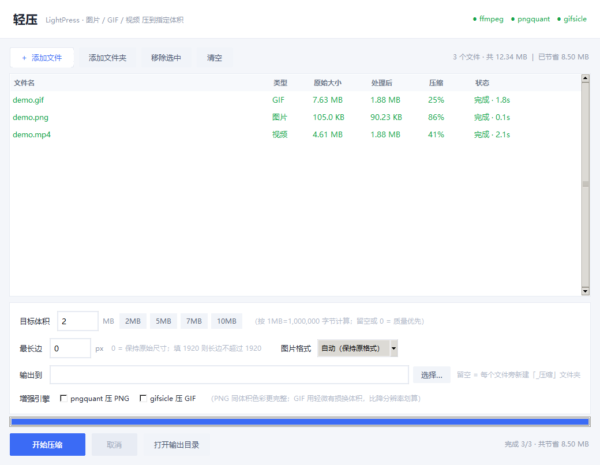

# 轻压 LightPress

> 把图片、GIF、视频压到指定体积的 Windows 桌面小工具 —— 拖进去，填个「7 MB」，点开始。



微信发不了（超过 10MB）、邮件附件被退（超过 25MB）、某个网站上传只让传 2MB……
这些限制的核心都是一句话：**把它压到 X MB 以内**。

市面上的工具大多让你调「质量 80」「CRF 23」这种参数，然后反复试、反复看体积。
轻压反过来做：你只告诉它目标体积，它自己迭代到那个数以内，并且尽量保住分辨率。

## 特性

- **目标体积优先**：填 7 就给你 ≤7MB，留空则走质量优先模式
- **三种文件统一处理**：图片（JPG/PNG/WebP/BMP/TIFF）、GIF、视频（MP4/MOV/MKV/AVI/WebM…）
- **批量 + 拖拽**：一次拖一堆进去，混着处理，原文件不动
- **两个可选增强引擎**：pngquant 压 PNG、gifsicle 压 GIF，勾上就有，取消就退回内置算法
- **单文件免安装**：`轻压.exe` 21MB，不写注册表，删文件夹即卸载
- **带命令行**：`轻压.exe --cli 视频.mp4 -t 7 -o D:\out`

## 效果

同一个 7.63MB / 2.5 秒的 GIF，压到不同目标体积时能保住的分辨率：

| 目标体积 | 仅内置算法 | 启用 gifsicle | 像素数 |
| --- | --- | --- | --- |
| 3 MB | 300×462 | **446×684** | ×2.2 |
| 2 MB | 246×376 | **390×600** | ×2.5 |
| 1 MB | 176×268 | **302×462** | ×2.9 |
| 0.5 MB | ~120×180 | **234×358** | ×3.0 |

代价是处理时间：一个 2.5 秒的 GIF 约 3 秒（内置）→ 12 秒（gifsicle）。

## 快速开始

### 直接下载

到 [Releases](../../releases) 下载 `LightPress-v1.1.0-win64.zip`，解压后双击 `轻压.exe`。
压缩包里已经带好了 ffmpeg / pngquant / gifsicle，开箱即用。

### 从源码运行

```bash
pip install -r requirements.txt
python app.py
```

再把下面三个可执行文件放到 `app.py` 同目录（或加进 PATH），GIF 和视频功能才会生效：

| 程序 | 用途 | 下载 |
| --- | --- | --- |
| `ffmpeg.exe` | 视频 / GIF 编解码 | https://www.gyan.dev/ffmpeg/builds/ |
| `pngquant.exe` | PNG 调色板量化 | https://pngquant.org/ |
| `gifsicle.exe` | GIF 帧间优化 + 有损压缩 | https://eternallybored.org/misc/gifsicle/ |

图片压缩只依赖 Pillow，不需要上面任何一个。

## 用法

1. 拖文件进窗口，或点「+ 添加文件」/「添加文件夹」
2. 填目标体积（比如 `7`），需要的话限制最长边
3. 点「开始压缩」
4. 结果默认输出到每个文件旁边的 `_压缩` 文件夹，双击列表行可直接打开

几个说明：

- **1MB = 1,000,000 字节**，比 Windows 资源管理器的 1,048,576 更严格，各种上传限制都不会卡线
- 压完如果比原文件还大，会保留原图并在状态里注明
- 目标实在压不进去时会明确报错并告诉你「最小只能到多少」，不会塞给你一个超标文件

## 三种文件分别怎么压的

**图片**：按目标体积二分搜索编码质量；最低质量仍超标就等比缩图重试。
走 pngquant 时改为二分「质量上限」，比内置的固定色阶更贴目标。

**GIF**：ffmpeg 生成专属 256 色调色板（`palettegen` / `paletteuse` + sierra2_4a 抖动 + 帧间差分）。

缩放比例**不能**按面积线性外推 —— 缩放会触发重采样和重新抖动，每像素体积接近翻倍。
所以先用一个小尺寸探针标定「每像素字节数」和 gifsicle 的折扣率，再一步算出目标尺寸，
最后用实测值微调，通常 3 轮内收敛。

gifsicle 的 `--lossy` 档位默认 40（实测肉眼无差别），仍超标时自动升到 60/80/100。

**视频**：H.264 两遍编码。按「目标体积 ÷ 时长」反算码率，编完实测超标就收紧码率重编（最多 3 轮）；
码率过低时自动降到 720p / 480p，避免糊成一片。

## 命令行

```bash
轻压.exe --cli 视频.mp4 -t 7 -s 1920 -o D:\out
```

| 参数 | 说明 |
| --- | --- |
| `-t, --target` | 目标体积（MB），0 或不填 = 质量优先 |
| `-s, --max-side` | 最长边像素，0 = 原尺寸 |
| `-o, --out` | 输出目录 |
| `-f, --format` | 图片输出格式：auto / jpeg / webp / png |
| `--no-pngquant` | 关闭 pngquant 引擎 |
| `--no-gifsicle` | 关闭 gifsicle 引擎 |

## 构建

需要 Python 3.11（带 tkinter）和 PyInstaller：

```bash
pip install -r requirements.txt
python make_icon.py
pyinstaller --noconfirm --onefile --windowed --name LightPress ^
  --icon app.ico --add-data "app.ico;." --collect-all tkinterdnd2 app.py
```

或者直接跑 `build.bat`。

> 打包出来的 exe 不含 ffmpeg / pngquant / gifsicle，需要另外放到同目录。
> 不建议把它们提交进仓库：ffmpeg 的 Windows 完整版有 140MB，超过 GitHub 单文件 100MB 上限。

## 已知限制

- 只测过 Windows 10/11，代码里有 `sys.platform` 分支但没在 macOS / Linux 上验证
- 视频压缩对长片很慢（两遍编码），暂时没有硬件加速
- GIF 的 gifsicle 搜索比纯内置慢 3~4 倍，文件多时建议先关掉

## 致谢

站在这些工具的肩膀上：[FFmpeg](https://ffmpeg.org/)、[pngquant](https://pngquant.org/)、
[gifsicle](https://www.lcdf.org/gifsicle/)、[Pillow](https://python-pillow.org/)、
[tkinterdnd2](https://github.com/Eliav2/tkinterdnd2)。

## License

[MIT](LICENSE)
